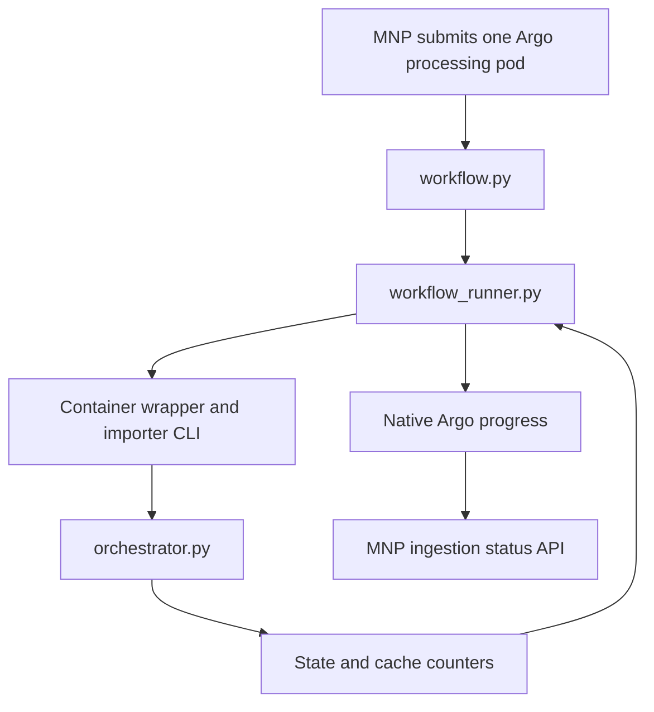

# CATMAID skeleton batch importer

This package appends a local ZIP of SWC skeletons to an existing CATMAID
tracing project, including one that already contains skeletons. It validates
inputs, plans whole-skeleton batches, loads them atomically, rebuilds existing
grid caches once and retains verification and audit files. Project, stack and
grid provisioning are prerequisites handled outside ingestion.

The single-pod workflow acquires a durable project ingestion lock before
downloading. The standalone local-ZIP CLI acquires it before batch loading.
Matching NeuroGlass middleware rejects edits on that project through cache
updates and verification while reads remain available. Enforcing the lock
requires no viewer polling or permission rewriting. Native CATMAID clients and
arbitrary database writers are outside this integration's contract and must not
edit the target.

## Single-pod ingestion workflow

### Application workflow use case

Use the complete workflow when an application accepts a remote SWC archive and
schedules ingestion into an already provisioned CATMAID project. For example,
MNP can accept an import request for a study's managed skeleton layer, record its
ingestion UUID and target project, then submit one Argo processing pod.

The pod runs `python -m catmaid_skeleton_batch_import.workflow` with the
source location, declared units, target, database settings and a fresh durable
workspace. CATMAID owns project-lock acquisition, download, preparation,
loading and final verification within that job. MNP owns authorization, workflow
submission and the durable application outcome.



The modules operate at different levels:

| Module | Responsibility |
| --- | --- |
| `workflow.py` | Acquire the project lock before download, sequence the commands and publish a terminal result. |
| `workflow_runner.py` | Supervise each preparation/import subprocess, retain logs, forward cancellation and publish live progress. |
| `orchestrator.py` | Execute the importer commands: capture target metadata, plan batches, load rows, rebuild caches and verify data. |
| `workflow_io.py` | Download archives and interpret retained execution evidence for terminal reporting. |
| `archive_sources.py` | Validate storage locations and decrypt signed download credentials. |

The runner remains in CATMAID alongside the local CLI and checkpoint formats.
MNP launches the public workflow entry point; it does not import these runner
helpers. If the ZIP is already local and the caller manages the command
sequence, use the standalone `preflight`, `plan` and `run` interface
below instead.

During execution, an API client can poll MNP's authorized ingestion-status GET.
MNP reads native Argo observations and decodes the current stage and counters;
it does not need the ingestion volume mounted into the backend. For example:

```json
{
  "status": "running",
  "progress": {
    "phase": "cache",
    "stage": 4,
    "total_stages": 5,
    "completed": 400,
    "total": 1000,
    "unit": "cells",
    "percent": 40
  }
}
```

This reports 40% of cache rebuilding, not 40% of total ingestion time. Argo
collection and MNP's ten-second observation cache can delay updates. A dedicated
frontend progress widget is not required to use this API.

Progress and completion follow separate paths. CATMAID writes
`terminal-result.json`; MNP exposes it as an Argo output parameter for its
exit notifier, then accepts the result through its Kafka consumer. Only that
accepted result establishes `succeeded`, `failed` or
`operator_attention`. A progress counter reaching its total does not prove
successful completion. See [State and progress](#state-and-progress) for the
retained checkpoints and [Single-use failure contract](#single-use-failure-contract)
for partial imports.

### Launch and configuration

For an orchestrated ingestion, install the workflow extras and run one finite
processing command:

```bash
python -m pip install './scripts/catmaid_skeleton_batch_import[workflow]'
python -m catmaid_skeleton_batch_import.workflow
```

The orchestrator supplies `SKELETON_INGESTION_ID`, a fresh
`SKELETON_INGESTION_WORKSPACE` ending in that UUID,
`SKELETON_INGESTION_WORKFLOW_NAME` and
`SKELETON_INGESTION_WORKFLOW_UID`. Source inputs are a public
`SKELETON_INGESTION_S3_URI` or an encrypted
`SKELETON_INGESTION_SOURCE_ENCRYPTED` with its
`SKELETON_INGESTION_SOURCE_KEY`. Also supply
`SKELETON_INGESTION_COORDINATE_UNIT`,
`SKELETON_INGESTION_TARGET_PROJECT_ID` and
`SKELETON_INGESTION_MAX_ARCHIVE_BYTES`, plus the normal database settings.

The command owns download → preflight → plan → run in order. Run includes
maintenance, updating existing caches and verification. It uses the same
single-attempt importer, source validation, three-attempt transfer budget and
retained-state checks. It refuses a nonempty workspace.
`SIGTERM` or `SIGINT` cancels the whole sequence, including between stages.
A running stage receives the signal and is reaped before exit; cancellation
does not start another stage even if the child exits successfully. Terminal
evidence is retained when it can be written during shutdown.

The runner bridges state/cache observations into the optional
`ARGO_PROGRESS_FILE` five-stage ratio. The package never calls NeuroGlass
or Kafka; MNP owns the API and terminal-notification integration.

Before exit it writes a bounded schema-1 `terminal-result.json` containing
the workflow identity and verified outcome/counts or a useful error. Missing or
conflicting execution evidence cannot establish success. A calling workflow
can expose this file as an output parameter so its exit notifier needs no disk
access. Pod loss before that hand-off still requires inspection; there is no
pod-loss recovery or automatic import retry.

All source/audit files remain until explicit cleanup. Workflow finalization only
classifies the result; it has no source-deletion decision or cleanup hook.
Retention belongs to the calling system or operator. Node maps are not sent
through the terminal output. In MNP, only the processing pod mounts the retained
RWO claim and workflows sharing it are serialized. The project-level lock blocks
NeuroGlass mutations while the layer keeps its normal visibility.

## Project-level ingestion lock

Migration `0127_project_active_skeleton_ingestion` adds the nullable UUID field
`Project.active_skeleton_ingestion` to both the live project and its CATMAID
history table/view. Deploy that migration and the matching NeuroGlass middleware
before importing. This does not alter users' project permissions.

The single-pod workflow acquires the durable project lock before downloading,
then retains it through preflight, planning, loading, maintenance, cache updates
and verification. At the start of `run`, it verifies the same ingestion UUID
still owns the project lock, without releasing and reacquiring it. The standalone
local-ZIP CLI acquires its project lock at `run`, before batch preparation.
Each ingestion UUID has one fresh workspace and one run attempt. The workflow
runs its commands sequentially; concurrent commands against the same state
directory are unsupported. There is no filesystem workspace lock.
NeuroGlass mutation requests use
`catmaid.ingestion_lock.project_write_guard()` for the whole write response.
Their shared project-row locks allow concurrent edits and finish before the
importer's exclusive row lock can establish the project lock. Lock acquisition uses the run's
configured lock timeout; no database transaction spans the full import.

Once the project lock is committed, the NeuroGlass middleware returns HTTP **423** with
`type: ProjectIngestionLocked` for mutation requests on that project. Read
requests, including POST-based reads, remain available. Other projects are
unaffected. This integration covers NeuroGlass access-token/task-association
requests, not native CATMAID clients or arbitrary database/background writers.
Lock enforcement requires no viewer polling or automatic layer-visibility change.

The project lock remains active across batch commits, database maintenance, existing-cache
updates and final verification. Verified completion clears only the matching
owner. A confirmed download/preflight/planning failure also clears it. Run
startup failure with every batch still planned clears it too.
A prepared/failed/committed batch or process loss leaves the project lock active; it has no
expiry and a new attempt cannot acquire or clear another owner's project lock.

After a confirmed wrapper startup failure, state can legitimately contain
`run.status: pending` and `project_lock.status: released`, with every batch still
planned and every final phase pending. This records safe cleanup, not loading
progress. Finalization reports `failed`, allowing a fresh request/workspace;
it does not resume the previous attempt. Unreleased or inconsistent state still
requires inspection.

The workflow closes its parent database connection after early acquisition,
on success or failure. Closing a connection does not release the durable project lock.
Preparation needs no idle parent session, and cleanup reconnects if required.

Planning retains one `ingestion_id` in `state/state.json`. It uses the
`SKELETON_INGESTION_ID` supplied by MNP, or generates a UUID once for a standalone
import. The same UUID owns `Project.active_skeleton_ingestion` throughout the
run. A supplied run-time UUID must match the planned identity.

The lock lifecycle is part of that same atomic state record:

```json
{
  "ingestion_id": "11111111-2222-4333-8444-555555555555",
  "project_lock": {
    "project_id": 123,
    "status": "pending"
  }
}
```

`project_lock.status` observes the run handoff through `pending`, `acquiring`,
`locked` and `released`. In the workflow, the project lock already exists before
planning publishes state. Standalone run saves `acquiring` before acquisition.
`released` is saved only after ownership-checked release succeeds, including a
safe workflow failure before run startup. There is no separate
lock-owner UUID or lock receipt file. An uncertain acquisition/release or an
`acquiring`/`locked` state requires operator attention, even before batch
loading. Successful workflow evidence requires a completed run and a released
lock in `state.json` for the matching ingestion. Earlier committed batches
are not rolled back and automatic retry/resume is still unsupported.

For manual resolution, first confirm the importer has stopped and reconcile the
retained state/assigned IDs against the database. Resolve any partial import
before unlocking. Through CATMAID's normal Django shell, use
`project_lock.project_id` and `ingestion_id` from the retained `state.json`. If
planning never published state, use the workflow's pinned project and ingestion
UUID and compare it with `Project.active_skeleton_ingestion`:

```python
from catmaid.ingestion_lock import release_project_ingestion
release_project_ingestion(project_id, ingestion_id)
```

The helper refuses a different owner. Do not release the project lock merely to retry a
failed archive; this is an inspection step, not a recovery command. Migration
rollback also refuses to remove a live lock. Refresh open viewers after success
to reload cached CATMAID data.

## File format contract

All versioned ingestion formats use `schema_version: 1`, including plans,
state, requests, command results, artifact metadata and cache progress. The
recorded `planner_version` is also `1`. These are file-format versions, separate
from the importer package version.

Only the current layouts are supported. Earlier development workspaces are not
compatible and are not converted; use a fresh workspace with the matching MNP
and CATMAID implementations. Do not edit a saved version number to reuse a
partially loaded workspace.

## Interface

Install the package in the same Python environment as CATMAID:

```bash
python -m pip install ./scripts/catmaid_skeleton_batch_import
```

Then prepare and run one ingestion:

```bash
# Capture the associated target stacks before database-free planning.
DJANGO_SETTINGS_MODULE=mysite.settings \
catmaid-skeleton-import preflight \
  --request /staging/request.json \
  --state-dir /staging/state

catmaid-skeleton-import plan \
  --request /staging/request.json \
  --state-dir /staging/state

DJANGO_SETTINGS_MODULE=mysite.settings \
catmaid-skeleton-import run --state-dir /staging/state
```

Each workspace supports one `run` invocation. The importer surfaces the first
failure immediately. It does not retry, resume committed batches, or offer a
`--rebuild-cache` recovery mode. Keep the workspace for diagnosis; use a new
workspace only after inspecting any data left by the failed attempt.

First run `preflight` with the same request and state directory. It reads
associated stack metadata and database identity into the local
`state/stack-geometry.json` snapshot without reading SWCs or changing CATMAID.
`plan` reads that snapshot and needs no database or Django initialization.
`run` reads only the durable state directory
and the unchanged local input files recorded there. Run the command from a
CATMAID application environment where `mysite.settings` and the `catmaid`
package are importable.

Planning checks every readable SWC and reports all invalid files together.
The CLI stdout and `state/result.json` contain a bounded summary, for example:

```json
{
  "schema_version": 1,
  "ok": false,
  "command": "plan",
  "importer_version": "0.7.0",
  "error": {
    "category": "invalid_input",
    "message": "2 SWC file(s) failed validation; see error-details.json for all files. First error: skeletons.zip:a.swc: expected exactly one root, found 5",
    "details": {"invalid_swc_count": 2},
    "details_file": "error-details.json"
  },
  "state_dir": "/staging/state"
}
```

`state/error-details.json` retains the full error message and details. Its
`error.details.member_errors` list contains one useful reason per invalid file:

```json
[
  {"member_path": "a.swc", "message": "skeletons.zip:a.swc: expected exactly one root, found 5"},
  {"member_path": "b.swc", "message": "skeletons.zip:b.swc:2: expected 7 columns, got 6"}
]
```

The summary never embeds that list. Error messages are capped at 2,000
characters and other detail metadata at 8 KiB; larger details remain only in
`error-details.json`. A file reference is included only after that file was
written successfully. Failure to save full diagnostics is logged, while the
original category/message is still emitted and saving `result.json` is attempted.
Without a writable state directory, stdout still carries the bounded error.
These files describe the latest failed command; a later successful result is
authoritative over any retained older error-details file.

An invalid archive produces no executable plan, even if some SWCs are valid.
Fix the reported files and plan a new ingestion in a fresh state directory. Archive-wide failures such as an
unreadable ZIP, duplicate ZIP paths, encryption, or archive-size limits still
stop immediately; per-file size/type checks and fragment-ID collisions are
reported with the other member errors.

## Input contract

An ingestion consists of a **request JSON file plus a local ZIP containing SWC
files**. No input CSV or manifest is required. Keep the ZIP unchanged and readable
until `plan` succeeds. After that, `run` uses the retained batch snapshots;
the original ZIP can be removed or moved to archival storage. Its path, size and
SHA-256 remain recorded in `state/archive.json` for audit.

### Request JSON

Every request targets an existing tracing project:

```json
{
  "schema_version": 1,
  "source": {
    "archive_path": "/staging/skeletons.zip",
    "coordinate_unit": "um"
  },
  "target": {
    "project_id": 123
  }
}
```

| Field | Required | Meaning |
| --- | --- | --- |
| `schema_version` | Always | Literal `1`. |
| `source.archive_path` | Always | Local ZIP path visible to all processing containers. Prefer an absolute path; relative paths resolve against the working directory. |
| `source.coordinate_unit` | Always | Exactly `"um"` or `"nm"` for every SWC's XYZ and known radii. |
| `target.project_id` | Always | Existing tracing project ID, a positive integer at most 2147483647. The project needs complete tracing setup and at least one associated stack with valid geometry. |

Unknown fields, including a `stack` provisioning request, are rejected. The
request has no annotation or cache override fields. The importer does not create
projects, stacks or grid definitions, change permissions or repair tracing setup.

Preflight reads the associated stacks' dimensions, resolution, XY/XZ/ZY
orientation and translation. Before orientation and translation,
`dimension[i] * resolution_nm[i]` gives a stack's physical extent along axis
`i`. For example, dimensions `[100, 200, 50]` at resolution
`[1000, 1000, 2000]` describe `[100000, 200000, 100000]` nm
(100 × 200 × 100 µm).

Planning checks every converted node against the union of the associated
stacks' project-space bounds. Boundary points are accepted; gaps between disjoint
stacks are outside their coverage. Negative XYZ values are accepted inside an
associated stack. For example, translation `[-1000, -2000, -3000]` nm and
physical size `[2000, 4000, 6000]` nm accept `[-500, -1000, -1500]` nm;
X = -1001 nm is outside that stack. SWC positions are converted by the declared
source unit and are never clipped, translated or otherwise registered.

Invalid members are collected in `error.details.member_errors` inside
`error-details.json`, and no executable plan is produced. Missing stacks or
invalid geometry also prevent planning. Radius `-1` and root parent `-1`
remain valid.

`plan` hashes and registers the local stack snapshot. Preflight must finish
before planning; changed metadata requires a new state directory and another
preflight. Stack geometry and database identity are checked before loading and
again during final verification. A missing or changed snapshot stops the run
before rows are loaded.

Existing skeletons, names, provenance, connectors, permissions, visibility,
stacks and cache definitions are preserved. Existing out-of-bounds or negative
coordinates are retained. Each incoming SWC creates a fresh neuron and skeleton;
the importer does not merge it into existing morphology. A provenance collision
is rejected before loading. Successful imports finish with `run.status: "complete"`
and `project_lock.status: "released"`.

### How source units are determined

CATMAID stores tracing coordinates and radii in nanometres, so the importer
converts the declared source units to nanometres before inserting rows.

**The caller must establish the units from the source dataset documentation,
exporter settings, or a reliable header/metadata statement before planning.**
The [SWC specification](https://swc-specification.readthedocs.io/en/latest/swc.html)
describes XYZ coordinates and radius in micrometres, but a `.swc` filename alone
does not prove that an exporter followed that convention. Do not infer units
from coordinate magnitudes alone. If the units are unknown, establish them with
the dataset provider before ingestion.

The importer treats the request's `source.coordinate_unit` as authoritative. It
ignores `#` comments, including any unit, scale or offset declarations; it
does not read image metadata or automatically detect a mismatch between the
request and the actual data.

| Declared value | Conversion to CATMAID nanometres |
| --- | --- |
| `"um"` | Multiply X, Y, Z and known radii by 1000. For example, X=12.5 becomes 12500 nm. |
| `"nm"` | Keep X, Y, Z and known radii unchanged. For example, X=12500 stays 12500 nm. |
| Radius `-1` | Remains `-1` (unknown radius), regardless of the declared unit. |

All SWCs in a ZIP must already share the declared physical unit and the target
project's coordinate frame. Mixed-unit archives and raw voxel/pixel coordinates
must be converted before ingestion. The associated stack's resolution does not
perform that conversion; translation, axis reordering, rotation and registration are also the
caller's responsibility.

### Files on disk and ZIP structure

Example files visible to the importer:

```text
/staging/
  request.json
  skeletons.zip
  state/                 # retained audit workspace for one import
    stack-geometry.json  # append metadata snapshot from preflight
```

Example members **inside** `skeletons.zip`:

```text
root-cell.swc
specimen-01/
  0021814.swc
specimen-02/
  1054599727.23.SWC
```

- SWCs may be at the ZIP root or in nested directories. Directory names have no
  special meaning; no particular top-level folder is required. Use `/` in member
  paths. The importer reads members directly without extracting them.
- Every regular file ending in `.swc` (case-insensitively) is imported as one
  skeleton. Other files are ignored; nested ZIPs are not recursively imported.
  The archive must contain at least one SWC. Encrypted members and duplicate
  archive-member paths are rejected; SWC symlinks/special files are rejected.
- The filename without its final extension, with leading and trailing whitespace
  trimmed, becomes the source fragment ID:
  `specimen-01/0021814.swc` creates `source-fragment:0021814`.
  Identifiers must be non-empty, at most 239 characters, and unique across the
  whole archive after trimming. `a/123.swc` and `b/ 123 .swc` conflict despite
  different folders. Whitespace-only identifiers are rejected.
  Leading zeros, case and dots are preserved as literal strings.
- Each SWC must fit within one batch's node limit (250,000 nodes by default).
  A large SWC is rejected rather than split automatically. Other archive/file
  size and count limits are listed under deployment settings.

### Content of each SWC

An SWC is UTF-8 text. Blank lines and full lines beginning with `#` are ignored.
Every other line must have exactly seven whitespace-separated columns:

```text
id  type  x  y  z  radius  parent_id
```

That heading describes the columns; do not put it into the file as an
uncommented row. Example file, with physical values expressed in micrometres and
`source.coordinate_unit` set to `"um"`:

```swc
# id type x y z radius parent_id
1 1 10 20 30 2 -1
2 3 11 20 30 0.5 1
3 3 12 21 30 -1 2
```

Full-line and trailing `#` comments are ignored. For example,
`2 3 11 20 30 0.5 1 # branch point` contains seven data fields. All remaining
fields are still validated strictly, with the original physical line number
included in errors.

`id`, `type` and `parent_id` are integers; XYZ and radius are finite numbers.
Node IDs are unique within a file and may be reused in other files: they are
local topology references, not CATMAID IDs. There must be at least one node,
exactly one root (`parent_id=-1`), valid parent references, and one connected
acyclic tree. After conversion to nm, XYZ must fit at least one associated target
stack. Coordinates may be negative when that stack's bounds include them.
A radius must be non-negative or exactly `-1` for unknown.
A one-node SWC creates a neuron/skeleton with one root, a zero-length root edge,
and a summary with `num_nodes=1` and `cable_length=0`; its provenance and cache
generation use the same path as larger skeletons.
The sample root becomes `(10000, 20000, 30000)` nm with radius `2000` nm.

## Batch import and cache rebuild

1. Acquire the target project's ingestion lock. The single-pod workflow does
   this before downloading; the standalone local-ZIP CLI does it at `run`.
   Lock acquisition waits for existing guarded edits to finish. Matching
   Neuroglass middleware rejects further mutations while the project is locked.
   Native CATMAID clients and other writers outside that middleware must avoid
   editing the target. No CATMAID service shutdown or layer-visibility change is
   required.
2. Run the import once. Every atomic batch uses bulk `COPY` with ordinary
   triggers bypassed only in the importer transaction, then explicitly creates
   and validates edges and summaries for that batch's new skeleton IDs. Existing
   skeletons and their derived data are not rematerialized or overwritten.
3. After **all** batches commit, rebuild each configured node grid cache once
   from the whole project's existing and imported data, including connectors.
   There are no per-batch cache refreshes or per-edge spatial notifications from
   the bulk load. A project with no grids requires no cache generation.
4. Verify imported IDs and exact node values, unchanged grid definitions, payload
   formats, LOD counts, rebuild timestamps and absence of dirty cache markers.
   Cache payload verification runs once in this final phase.
   The importer releases its project lock after verified run completion.
   Refresh open viewers after success.

For existing targets, grid IDs, dimensions, orientation, filters, ordering, LOD,
JSON/JSON-text/MessagePack format flags, `allow_empty` and enabled/disabled state
are preserved. Only payload cells are replaced, including those of disabled grids.
Cache generation has no node query limit. Existing
grid filters and ordering still apply; `NODE_LIST_MAXIMUM_COUNT` does not
truncate the importer's rebuilt payloads. This workflow uses grid caches only.
Bounds cover all project nodes and connectors, including negative coordinates
and long edges. Intentionally cached empty coverage is retained for grids with
`allow_empty`. Ingestion always uses the existing grid definitions.

Read endpoints remain available and the layer keeps its normal visibility,
but reads can observe intermediate batch commits and cached views can be stale
or incomplete while payloads are rebuilt. Guarded edits remain blocked through
final verification. Other projects and the CATMAID service remain available,
although database load may slow requests.

A failed rebuild leaves committed skeleton batches intact, retains the project
lock and terminates the run. The saved cache plan and receipt are audit evidence.
Inspect the database and retained files and resolve any partial import before
manually releasing the matching ingestion's project lock.


## Source fragment identifiers

Every SWC creates one protected `source-fragment:<fragment_id>` annotation on
its modeled neuron. The identifier is the archive-member basename with the final
`.swc` extension removed case-insensitively, then leading and trailing whitespace
trimmed (including Unicode whitespace). For example,
`191805/0021814.swc` yields `0021814`, and `1054599727.23.SWC` yields
`1054599727.23`. `folder/ 0021814 .swc` also yields `0021814`. Values remain
strings: leading zeros, case, dots, internal whitespace, Unicode characters and
template-looking text such as `{n}` are preserved. Original ZIP member paths are
retained in the manifest. Display names normally retain the filename stem; the
exact display value `\N` is sanitized to `_N` so PostgreSQL COPY cannot interpret
it as NULL. This affects neuron/skeleton labels and the manifest's `name` field;
the source fragment ID and its annotation remain literal and unchanged.

Planning rejects empty identifiers, duplicate identifiers anywhere in the
archive after trimming, and identifiers longer than 239 characters after trimming.
The last limit leaves room
for the 16-character prefix in CATMAID's 255-character annotation field. It is
per identifier, not a combined limit on the number or total length of a
segment's contributing identifiers. Visible neuron and skeleton names keep
CATMAID's normal behavior and are not the source of truth for these values.

For an existing target, `run` rejects incoming fragment IDs that already have a
`source-fragment:` annotation in that project, before loading any batch. It does
not automatically skip, overwrite or merge them. This also applies to provenance
retained after a merge or split. Every run uses fresh IDs and rejects all existing
fragment collisions. For a new import, exclude already-imported fragments;
folder names do not provide a dataset
namespace, so different datasets with overlapping IDs require distinct source
identifiers before ingestion.

The merge and split inheritance rules are implemented in the **CATMAID backend**
in this branch, in the normal `POST /{project_id}/skeleton/join` and
`POST /{project_id}/skeleton/split` operations. Deploy this backend version; clients
using these endpoints do not need to calculate or submit provenance unions or
copies. After a successful operation the client should reload annotations/source
metadata to update its display. A custom direct-database editing path bypasses
these API rules. No Neuroglass UI changes are included here.

Merges retain the union of both source-identifier sets, including with an empty
client annotation selection. Splits copy the entire set to both results,
including when a client requests no ordinary annotations on the new half.
Duplicates are not linked twice. This records inherited provenance; after a
split it does not assert that every original fragment still supplies nodes to
both results.

Join/split operations wait up to `SKELETON_EDIT_LOCK_TIMEOUT_MS` (default `1000`,
one second) per contended neuron lock, then return a retry error if contention
persists. Configure this positive integer in CATMAID's web Django settings
(`mysite.settings`); it is separate from the importer's batch timeouts. An
existing stricter database lock timeout is respected. The previous timeout is
restored after acquisition or failure. Provenance, edit permissions and node
ownership are read or rechecked after acquisition; joins also refresh names and
stable-winner selection. Existing treenode `NOWAIT` behavior is unchanged.

The namespace is importer-managed. Manual creation, attachment, rename,
replacement and removal through CATMAID editing APIs return HTTP 403, including
for ordinary superuser editing requests. Trusted structural copies and merges
preserve literal identifiers. Native SWC annotation replacement keeps existing
source identifiers, but native SWC uploads do not start generating them. Whole
neuron, skeleton and project deletion still work normally.

Deleting a whole neuron, or its final skeleton node, also removes annotations
that no other entity uses. Shared provenance survives until its last use is
deleted. Cleanup locks the affected annotation rows in ID order and rechecks
usage in the same transaction, so concurrent deletions cannot leave orphan
provenance. This allows a fresh import of a fully deleted source fragment while
retaining collision rejection for fragments still present in the project.

The importer generates a compressed source-to-CATMAID CSV manifest with exactly
`member_path,fragment_id,neuron_id,skeleton_id,node_count,name,batch_index`.
This is an output audit artifact, not an input requirement. The filename-derived
`fragment_id` is recorded separately from display `name` and the allocated
CATMAID IDs. Annotation rows and links commit or roll back in the same atomic
batch as morphology, and final verification checks the exact values and ownership.
Final verification loads each SWC once per batch and reuses the prepared values
for metadata, topology, summary and exact node checks.

Each batch also writes `state/batches/000001/node-map.csv.gz` (using the batch
index) with exactly `member_path,source_node_id,treenode_id`. There is one row
per imported node, for example:

```csv
member_path,source_node_id,treenode_id
folder/0021814.swc,42,900123
folder/0021814.swc,7,900124
other/0021815.swc,42,900125
```

`member_path` is the complete ZIP member path; SWC node IDs are local to that
file and need not be ordered or consecutive. `treenode_id` is the exact CATMAID
ID assigned during COPY. Read both ID columns as integers without floating-point
conversion. Join with the manifest on `member_path` for the imported skeleton
and neuron, and use `project-context.json` for the target project.

The mapping is streamed, gzip-compressed, atomically written and registered
with its row count and SHA-256 in `state.json` before the batch transaction.
Only a batch with status `committed` confirms that its mapped nodes were loaded;
`prepared` or `failed` mappings describe reserved IDs whose commit is not confirmed.
Final verification requires these saved mappings and checks them against the source
rows, reserved IDs and exact database rows.
Retain the state directory on durable storage after the import if a review
queue will need these mappings. They add no per-node CATMAID labels or new
database table. They record import-time identity: merges and splits retain node
IDs but can change their skeleton membership, and deleted nodes no longer exist.

### Search and audit API contract

Use the existing project-authorized CATMAID APIs in two steps. First resolve an
exact annotation name to its annotation ID:

```text
POST /{project_id}/annotations/query-targets
types[0]=annotation
name=source-fragment:0021814
name_exact=true
name_case_sensitive=true
with_annotations=false
```

CATMAID's existing search behavior is unchanged: it trims the search string and
uses LIKE for exact, case-sensitive queries. Before form-encoding the full
annotation name, double any backslashes for LIKE escaping (a fragment ID
`path\name` needs the query value `source-fragment:path\\name`). CATMAID already
escapes `%` and `_`; the `source-fragment:` prefix prevents leading-slash regex
interpretation. Check that a result's name equals the full expected annotation
name. If no annotation is found, return no matches; do not issue an unfiltered
second query. Then find the currently
associated neurons and skeletons using the numeric annotation ID:

```text
POST /{project_id}/annotations/query-targets
types[0]=neuron
annotation_reference=id
annotated_with=<annotation_id>
with_annotations=true
```

The response's entities include the current neuron `name` and `skeleton_ids`.
Using annotation IDs for the second call avoids comma-delimited name parsing.
For a batch audit, `POST /{project_id}/annotations/forskeletons` accepts
`skeleton_ids[0]`, etc., and returns skeleton annotation links plus an
annotation-ID-to-name dictionary. Filter the exact `source-fragment:` prefix
and remove it once to recover each complete identifier string.

A later Neuroglancer integration can route fragment searches through these
calls and refresh source metadata after merges and splits. Keep fragment IDs
as strings separately from numeric CATMAID skeleton IDs. This change does not
add viewer code or append all identifiers to visible labels.

## Container ingestion entry point

The CATMAID image includes the package and a headless runtime wrapper:

```bash
# Capture target metadata before database-free planning.
SKELETON_INGESTION_WORKSPACE=/staging \
/home/env/bin/python /home/scripts/docker/run_catmaid_skeleton_import.py preflight

SKELETON_INGESTION_WORKSPACE=/staging \
/home/env/bin/python /home/scripts/docker/run_catmaid_skeleton_import.py plan

SKELETON_INGESTION_WORKSPACE=/staging \
/home/env/bin/python /home/scripts/docker/run_catmaid_skeleton_import.py run
```

The existing absolute workspace must contain `request.json`; the wrapper creates
its `state` directory for one attempt. `plan` uses the preflight snapshot
and environment/default planning limits without loading Django settings.
Both `preflight` and `run` require
`DB_HOST`, `DB_NAME`, `DB_USER` and `DB_PASS`, with optional `DB_PORT` (default
5432), and use `mysite.ingestion_settings` without starting the web server or
applying migrations. Readiness uses one `pg_isready` check; a failed check
immediately terminates the attempt. No readiness polling or ingestion retries
are performed.

Apply CATMAID migration `0126_fix_single_node_selective_summary` through the
normal deployment migration process before running this importer. It fixes
selective summary rebuilding for single-node skeletons. Also apply migration
`0127_project_active_skeleton_ingestion` for the durable project lock and matching
history schema. Deployment is responsible for applying migrations; the importer
does not inspect migration history.

`CATMAID_PROJECTS_DIRECTORY` defaults to `/home/django/projects`, and
`CATMAID_INGESTION_MEDIA_ROOT` defaults to
`/tmp/catmaid-skeleton-ingestion-media`. A failed readiness check or child records a terminal
result in `state/run-wrapper-result.json`. The wrapper refuses to start
another child in a workspace with that marker. Success is reported through
`result.json`.
For these individual wrapper commands, input downloads, workflow submission and
failure cleanup remain the caller's responsibility. The complete single-pod
workflow handles downloading and project-lock ownership as described above.

## Deployment settings

Settings come from environment variables and defaults. Django settings overrides
are not used. `plan` resolves four planning limits and records them in state
for audit. `run` reads the recorded batches and existing database grid
definitions directly; it resolves only its statement and lock timeouts.

| Environment variable | Read by | Default |
| --- | --- | --- |
| `CATMAID_BATCH_IMPORT_MAX_NODES_PER_BATCH` | plan | `250000` |
| `CATMAID_BATCH_IMPORT_MAX_ARCHIVE_BYTES` | plan | `2147483648` (2 GiB) |
| `CATMAID_BATCH_IMPORT_MAX_SWC_BYTES` | plan | `2147483648` (2 GiB) |
| `CATMAID_BATCH_IMPORT_MAX_TOTAL_NODES` | plan | disabled |
| `CATMAID_BATCH_IMPORT_STATEMENT_TIMEOUT_MS` | run | `0` (unlimited) |
| `CATMAID_BATCH_IMPORT_LOCK_TIMEOUT_MS` | run | `30000` |

There is no SWC file-count cap. ZIP size, each SWC's uncompressed byte limit and
the per-batch node budget remain enforced. Every SWC must fit one whole batch.
Cache dimensions, LOD, filters and formats come from the target project's
existing definitions; ingestion has no default-grid creation settings.
Effective database timeouts are recorded in `metrics.json`.

## Single-use failure contract

Each skeleton stays inside one atomic database batch. Core rows, model links,
fragment provenance, edges, summaries and validation commit together.

The importer stops on the first failure and records a terminal failed attempt.
Previously committed batches remain in CATMAID. A failure during COMMIT can leave
the current batch's database outcome unconfirmed; retained IDs and node maps
identify the rows to inspect. The importer does not retry, resume, reconcile or
delete data automatically. A hard-killed run also cannot be started again from
the same workspace.

Planning publishes `state.json` once, after the plan, batch snapshots and the
associated-stack snapshot have been written and verified. Failed initialization
publishes no executable state.

Existing permissions and visibility remain unchanged. The project ingestion lock
blocks NeuroGlass writes throughout workflow processing, including download and
planning, through final verification. After failure,
inspect the database and retained evidence before resolving a retained lock or
choosing cleanup or a new import.

## State and progress

The directory supplied through `--state-dir` contains inputs, saved IDs,
batch snapshots, maps, manifests and progress for one import. Keep it on durable
storage for diagnosis and later review-queue mapping. `state.py` atomically
replaces JSON so readers see complete records. The run marker
moves once from pending to running and then complete or failed; an interrupted
running attempt cannot be resumed.

The importer uses three status enums in `statuses.py`. JSON stores their plain
string values:

| Tracking | Values | Meaning |
| --- | --- | --- |
| Each batch (`BatchStatus`) | `planned`, `prepared`, `committed`, `failed` | Whether that atomic batch was started and its commit confirmed. A failed/prepared batch can have an uncertain COMMIT outcome. |
| Run, final phases and metrics (`OperationStatus`) | `pending`, `running`, `complete`, `failed` | Lifecycle of the run, each final phase, or diagnostic collection. |
| Project lock (`ProjectLockStatus`) | `pending`, `acquiring`, `locked`, `released` | The run's confirmed observations of project-lock ownership. |

`selected_project_id` is `null` until the existing target's tracing context
has been validated and recorded, then contains that project ID. It cannot be
changed. There is no separate project-selection status or saved overall status.
Progress readers use batch and phase checkpoints directly, so a failed run can
still report its committed prefix and retained project lock.

For example, after a failure in the second of three batches, the state contains:

```json
{
  "selected_project_id": 123,
  "run": {"status": "failed"},
  "project_lock": {"project_id": 123, "status": "locked"},
  "batches": [
    {"index": 1, "status": "committed"},
    {"index": 2, "status": "failed"},
    {"index": 3, "status": "planned"}
  ]
}
```

This is an excerpt; the state also retains the plan, artifacts and final phases.
CLI command results use `ok`, `command` and result metadata without another
overall `status` field. Workflow terminal outcomes remain `succeeded`,
`failed` and `operator_attention`. Success still requires a completed run,
committed batches, completed final phases, verified artifacts and confirmed
project-lock release.

Database maintenance runs after every batch has committed and before cache rebuilding.
It executes PostgreSQL `ANALYZE` on `class_instance`,
`class_instance_class_instance`, `treenode`, `treenode_edge` and
`catmaid_skeleton_summary`. This refreshes query-planner statistics after the
bulk load so subsequent queries can choose appropriate execution plans. It
does not alter skeletons, rebuild indexes or run `VACUUM`. The phase is
recorded in the audit state and runs once per import.

| File in the state directory | Purpose |
| --- | --- |
| `state.json` | Ingestion UUID, selected project ID, project-lock lifecycle, run outcome and confirmed phase/batch statuses. |
| `metrics.json` | Planned/completed batch, skeleton and node counts; operation durations, per-operation row counts and the run's effective settings. |
| `result.json` | Outcome of the most recent CLI command; failures contain a bounded summary and optional diagnostic-file reference. |
| `error-details.json` | Full diagnostics of the latest failed CLI command, including all invalid SWC members; never sent through the terminal callback. |

Metrics are observational: completed counts reflect confirmed committed batches. Loading progress advances after a batch commits.
Cache rebuilding has a running phase in `state.json` and optional live cell
counters in `cache-progress.json` (see measured cache progress below).
The orchestrator measures operation durations with its monotonic clock and
writes them through `MetricsStore`. Loader timings collected during each batch
transaction are buffered and appended together with one atomic metrics-file
replacement after the transaction commits or rolls back. Other completed phases
are recorded individually. Live phase progress comes from `state.json` and
`cache-progress.json`, independently of metrics.
All planned nodes can therefore be loaded while cache rebuilding or final
verification is still running.

There is no client-facing HTTP progress endpoint. A backend can read these files
from shared storage and expose a status summary to a polling client. Combine the
state and counts with deployment job/process status to detect a stopped
importer; the files are not a heartbeat. An import is successful only when its
run is complete and its project lock is released. Node counts reaching 100%
do not establish completion.

## Exit codes

| Code | Meaning |
|---:|---|
| `0` | Command completed successfully |
| `1` | Unexpected internal failure |
| `2` | Invalid request, archive, setting, or deployment precondition |
| `3` | Operational failure or interruption; terminal for this attempt |
| `4` | Immutable request/archive/plan/database target mismatch |
| `6` | Final read-only verification failed |

The command writes one versioned JSON result to stdout and progress diagnostics
to stderr.

## Tests

Run the standalone suite, including the optional workflow tests, with:

```bash
python -m pip install './scripts/catmaid_skeleton_batch_import[workflow]'
python -m pytest -q scripts/catmaid_skeleton_batch_import/tests
```

The Django provenance API tests also exercise concurrent cleanup, rollback, and
overlapping split/join operations against PostgreSQL. With a configured CATMAID
test database, run:

```bash
cd django/projects
python manage.py test \
  catmaid.tests.apis.test_source_fragment_annotations \
  catmaid.tests.apis.test_source_fragment_skeletons
```

The opt-in PostgreSQL tests independently provision existing targets through
ordinary CATMAID models, then test append behavior, exact geometry, summary
parity, cache preservation, rollback and terminal failures. The importer itself
never provisions those targets. Use only a disposable, migrated CATMAID/PostGIS
database; the tests leave their targets for inspection. Name that database and
pin its PostgreSQL cluster identity explicitly before enabling the database tests:

```bash
CATMAID_BATCH_IMPORT_E2E=1 \
CATMAID_BATCH_IMPORT_LOCAL_TEST=isolated \
CATMAID_BATCH_IMPORT_TEST_DB_HOST=catmaid-test-db \
CATMAID_BATCH_IMPORT_TEST_DB_NAME=catmaid_test \
CATMAID_BATCH_IMPORT_TEST_DB_SYSTEM_IDENTIFIER='<disposable cluster identifier>' \
DJANGO_SETTINGS_MODULE=mysite.settings \
python -m pytest -q \
  scripts/catmaid_skeleton_batch_import/tests/test_e2e_postgis.py \
  scripts/catmaid_skeleton_batch_import/tests/test_edges_postgis.py \
  scripts/catmaid_skeleton_batch_import/tests/test_project_lock_postgis.py \
  scripts/catmaid_skeleton_batch_import/tests/test_project_lock_migration_postgis.py
```

The configured Django connection must match the named host and database. Obtain
the cluster identifier from that disposable database with
`SELECT system_identifier::text FROM pg_control_system()`; no production target
is a suitable substitute. These checks run before the tests create any projects.

The project-lock tests use separate PostgreSQL sessions and observe actual lock
waits to check concurrent edits, acquisition races, connection loss, ownership
and timeouts. Apply migration `0127` before running them.
The migration tests exercise forward/reverse schema changes, history tracking
and refusal to reverse an active lock. They create and drop temporary clones of
the guarded database rather than downgrading its shared schema. The configured
database role therefore needs `CREATEDB` and access to the `postgres`
maintenance database; no other sessions may use the template while it is cloned.

## Edge materialization

Edge materialization creates edges from a validated temporary copy of each
prepared batch, using PostgreSQL `real` coordinates to match CATMAID's stored
precision.
It checks recorded IDs, ownership, and parent membership before inserting one
edge per node. Roots retain NULL parents and zero-length geometry. Existing
edges cause an error and batch rollback; no edges or connector materializations
are deleted or rebuilt.

Core rows, edges, CATMAID's selective summary refresh, and validation remain
inside one atomic transaction. Current-format state files keep their immutable
settings and recorded IDs for inspection. Every batch executes once; a failure
terminates the attempt while preserving earlier confirmed commits.

Metrics record `edge_staging`, `edge_creation`, and `summary_refresh` within the
existing `materialization` aggregate, plus the executing importer version for
each run. Do not add these child timings
to `materialization`, because they overlap.

Paired local benchmarks on a populated 42.5-million-node database measured
2.78x faster edge work, including staging, and 53.9% lower batch transaction
time when comparing sums of per-fixture medians. The 113-test correctness run
and full 171-batch rehearsal passed. These are local measurements and do not
establish a cluster speedup.


## Batch snapshots and local node maps

Planning retains validated source nodes through `batch_snapshot.py` in deterministic
gzip JSON-lines files, one bounded file per whole-SWC batch:
`batch-snapshot-000001.jsonl.gz`, `batch-snapshot-000002.jsonl.gz`, and so on.
The plan's `batch_snapshots` descriptors bind each file's SHA-256, byte size and
node count. Loading and final verification reuse these values instead of
reparsing SWCs. Source-unit double precision and normal conversion remain.
Snapshot hashes establish source identity; summary verification calculates cable
length from stored float32 coordinates. It does not compare cable lengths computed
before and after unit conversion, whose floating-point rounding can differ.
Both loading and final verification require the snapshot files. Execution verifies
their hashes and the retained metadata without rereading the original ZIP.
Retain the complete state directory through loading and final verification; keep
its node maps and manifests afterward for audit and review-queue mapping.

The feature is unpublished and supports only the current plan/state format.

The importer saves per-batch manifests and node maps in its local state directory.
It has no NeuroGlass dependency, network callback or mapping-table migration.
MNP mounts a dedicated retained RWO volume only into its finite processing pod.
The separate exit reporter reads a compact Argo output and publishes it through
Kafka without mounting that volume. Maps remain files; NeuroGlass stores only
the terminal result. A separate read-only microtask workflow is future work.

MNP and the standalone importer perform one attempt. Retained files support
inspection and review-queue mapping, not automatic recovery. Process loss or
partial import leaves the project lock set until verified operator resolution.


## Measured cache progress

Cache rebuilding optionally writes `state/cache-progress.json` containing
`schema_version: 1`, `completed` and `total`. Total is the sum of the planned
cell ranges across all configured grids. Completed increments only after a cell
refresh succeeds, including empty cells that intentionally leave no stored row.
Before a cache attempt starts, the orchestrator resets the observation to 0/0,
including before potentially slow coverage planning. Once coverage is known,
rebuilding publishes 0/total and then successful cell counts. No configured coverage reports 0/0.

This bounded observational file is replaced atomically at most once per second,
plus the initial and final updates. A progress-file IO failure is nonfatal.
The file is observational and is not registered as an immutable artifact. Cache receipts, state transitions and final verification still decide
completion. The optional CATMAID workflow bridge translates these observations
and confirmed batches into native file progress. Core importer execution does
not query Argo or depend on NeuroGlass.
